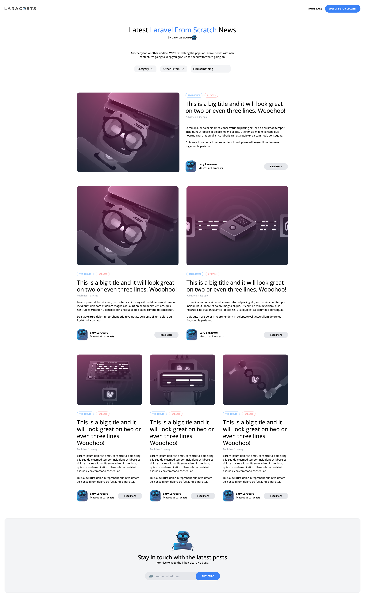

## Laravel-blog starten

De Laravel-app staat in `laravel-app`. Start Docker Desktop en voer vanuit die map uit:

```powershell
cd laravel-app
docker compose up -d --build
docker compose exec app php artisan migrate --seed
```

Open daarna [http://127.0.0.1:8020](http://127.0.0.1:8020). Artikelen, auteurs, categorieën en pagina-instellingen komen uit MySQL. De originele `index.html` en `post.html` zijn statische bestanden; gebruik de URL hierboven voor de Laravel-versie.
